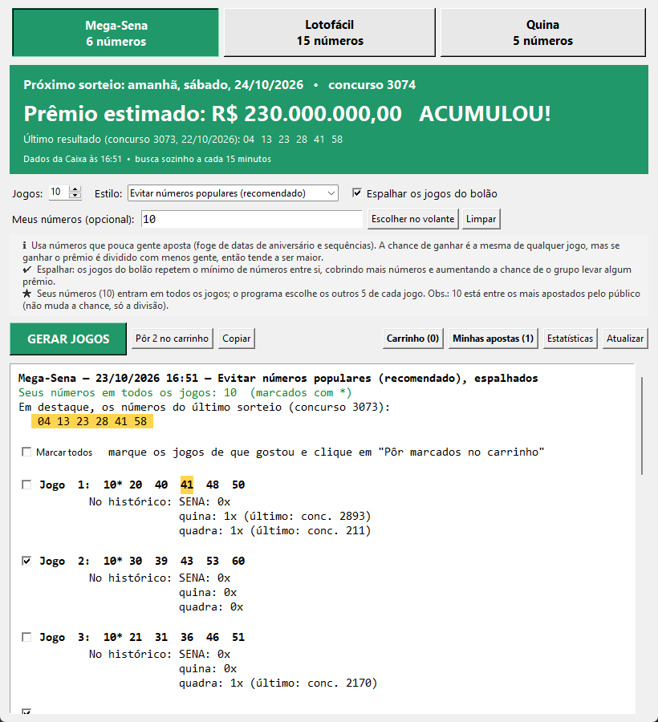
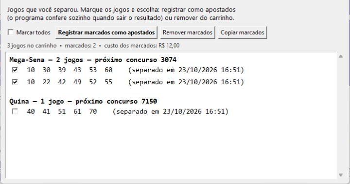
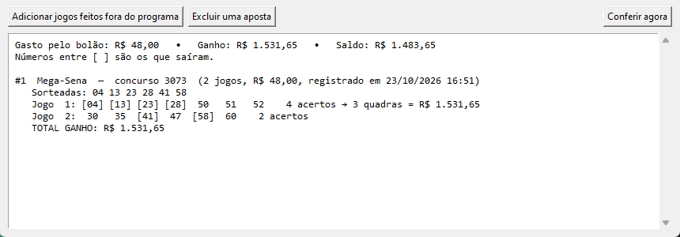
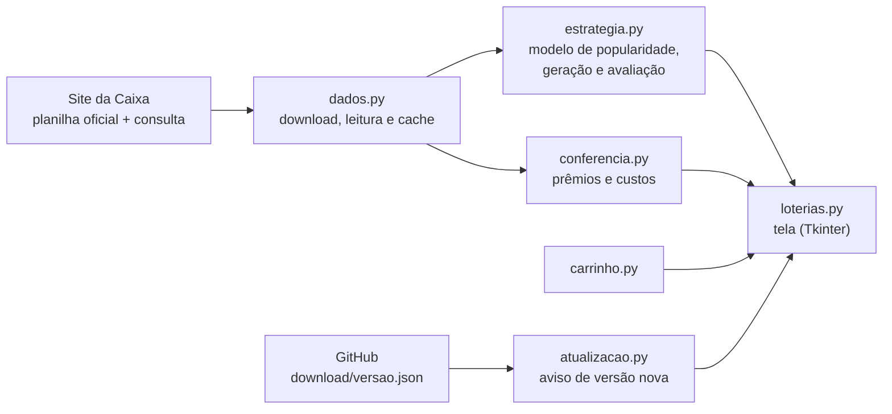

# Gerador do Bolão — Mega-Sena, Lotofácil e Quina

[](https://github.com/hericsaliby/bolao-lotericas/actions/workflows/testes.yml)


App desktop que usa os **dados públicos da Caixa** para montar o bolão do escritório:
a mesma chance de ganhar, mas **prêmio até 2x maior quando ganhar**, conferência
automática dos resultados e nada de jogo repetido.



## ⬇️ Baixar e usar

**[Baixar a versão mais nova (Windows)](https://github.com/hericsaliby/bolao-lotericas/raw/main/download/Gerador-Bolao.zip)**

1. Extraia o zip e abra o **Gerador Bolao.exe**. Não precisa instalar nada.
2. Se o Windows mostrar *"O Windows protegeu o computador"*: *Mais informações* > *Executar assim mesmo*.
3. Quando sair versão nova, o próprio programa mostra uma faixa amarela no topo.

## A ideia em números

Todo jogo tem a mesma chance de ser sorteado, mas o prêmio é **dividido** entre os
ganhadores. Analisando 17 mil concursos da Caixa:

- **O público aposta em datas** (1 a 31). Na Mega-Sena, sorteios só com números até
  31 tiveram **1,69x** mais ganhadores que o normal; sorteios sem nenhum, **0,71x**.
- **Um modelo estatístico** estima o quanto cada número é apostado. Validado em 300
  concursos que ele não viu: correlação de **0,84** na Mega-Sena e **0,96** na Quina.
- **Resultado:** os jogos gerados rendem em média **~1,5x** o prêmio de um jogo comum
  na Mega-Sena e **~1,25x** na Quina, sem perder chance.
- **"Números quentes" não funcionam:** num backtest com 2.972 concursos, a vantagem
  aparente some nos dados recentes. O programa diz isso claramente.

Método, tabelas e limitações: **[docs/METODOLOGIA.md](docs/METODOLOGIA.md)**.

## Funcionalidades

| | |
|---|---|
| **Gerar jogos** | Nunca sorteados e nunca repetidos; três estilos (evitar populares, aleatório, quentes) |
| **Espalhar o bolão** | Os jogos repetem o mínimo de números entre si: mais chance de o grupo levar algum prêmio |
| **Meus números** | Fixe os números de que gosta (digitando ou num volante na tela); o programa completa o resto |
| **Carrinho** | Marque os jogos de que gostou, guarde no carrinho e depois registre ou remova |
| **Conferência automática** | Avisa quando sai o resultado e quanto o bolão ganhou, inclusive em jogos de 7+ números |
| **Gasto × ganho** | Saldo do bolão com os preços da tabela da Caixa |
| **Próximo sorteio** | Data, prêmio estimado e números do último sorteio em destaque |
| **WhatsApp** | "Copiar" monta a mensagem pronta para o grupo |

<p align="center">
  
  
</p>
<p align="center"><sub>Carrinho e conferência automática (imagens com jogos de demonstração).</sub></p>

## Por dentro



**Destaques técnicos**

- **Dados:** leitura da planilha `.xlsx` oficial sem bibliotecas externas, cache
  incremental, nova tentativa quando a Caixa limita pedidos (HTTP 429) e descoberta
  automática do servidor da Caixa (que mudou de endereço durante o projeto).
- **Estatística:** regressão aditiva com regularização para separar o "peso" de cada
  número, validação fora da amostra, backtest de estratégias e simulação de Monte
  Carlo com teste de significância antes de mostrar qualquer diferença.
- **Engenharia:** módulos separados por responsabilidade, 27 testes automáticos
  rodando no GitHub Actions a cada envio, `.exe` com PyInstaller e aviso automático de
  versão nova.
- **Produto:** feito para colegas não técnicos. Linguagem simples, explicação de
  cada opção na tela e transparência sobre o que **não** aumenta a chance.

## Rodar pelo código

Requer Python 3.10+ (só biblioteca padrão).

```bash
python loterias.py                              # abre o programa
python -m unittest discover -s tests -t . -v    # roda os testes
pyinstaller --onefile --windowed --name "Gerador Bolao" loterias.py   # gera o .exe
```

| Arquivo | Função |
|---|---|
| `loterias.py` | Tela |
| `dados.py` | Download e leitura dos dados oficiais da Caixa |
| `estrategia.py` | Modelo de popularidade, geração dos jogos e chances |
| `conferencia.py` | Apostas, conferência de prêmios e custos |
| `carrinho.py` | Jogos separados para decidir depois |
| `atualizacao.py` | Versão do programa e aviso de versão nova |
| `tests/` | Testes automáticos |
| `docs/` | Metodologia e imagens |
| `download/` | Zip da versão atual e `versao.json` (lido pelo aviso de versão nova) |

## Aviso

Projeto pessoal, sem vínculo com a Caixa. Loteria é diversão: o programa não
aumenta a chance de ganhar e mostra as chances reais de cada prêmio.

## Autor

**Heric Saliby** · [GitHub](https://github.com/hericsaliby)
